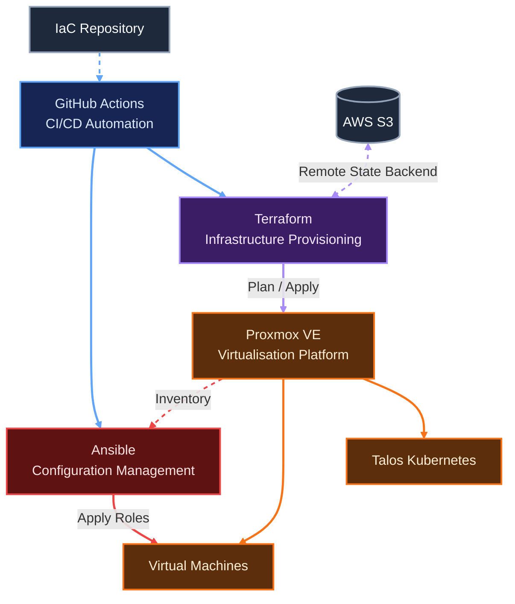

# Platform Automation

Infrastructure as code for a Proxmox platform. Terraform provisions cloud images,
virtual machines, and a Talos Kubernetes cluster. Ansible configures VM services,
and GitHub Actions runs deployments over WireGuard.

## Architecture



GitHub-hosted runners reach the private network through WireGuard. Service VMs
use AlmaLinux 10; Kubernetes nodes use Talos Linux and are configured through the
Talos API.

## Repository layout

| Path | Purpose |
| --- | --- |
| [terraform/environments](terraform/environments) | Terraform roots, each with its own state |
| [terraform/modules](terraform/modules) | Reusable cloud-image, virtual-machine, and talos-cluster modules |
| [ansible](ansible/README.md) | Dynamic Proxmox inventory, playbooks, and roles |
| [.github/workflows](.github/workflows) | Terraform, Ansible, S3 bootstrap, and state unlock workflows |
| [.github/actions](.github/actions) | Shared WireGuard, SSH, and Ansible actions |

Enabled roots are `dev/sandbox`, `dev/vault`, `dev/talos`, and `prod/images`.
Talos is included in automatic discovery and manual deployments. See the
[Talos module guide](terraform/modules/talos-cluster/README.md) for networking,
deployment, and cluster lifecycle procedures.

When forking, adapt the environment variables, VM addresses, and WireGuard setup
to your own infrastructure before running deployments. To exclude a root from
GitHub Actions, add a `.disabled` file in its directory. This optional marker
excludes it from automatic discovery and both manual modes; local Terraform
commands still work. Remove the marker to include the root again.

## Deployments

The [Terraform workflow](.github/workflows/terraform.yml) discovers roots from
changes under `terraform/environments`. Changes to shared modules, workflow
scripts, or the Terraform workflow select all enabled roots.

| Trigger | Behavior |
| --- | --- |
| Pull request to `main` | Format, validate, and produce preview plans for affected roots |
| Push to `main` | Plan affected roots, then queue apply for environment approval |
| Manual, `single` mode | Plan the selected environment and target |
| Manual, `all` mode | Plan every enabled root in the selected environment; ignore the target input |
| Manual, `destroy: true` | Generate a destroy plan, then queue destroy for approval on `main` |

Manual apply runs also require `main`. Destruction is only triggered manually.
Before removing a root's configuration, destroy its resources explicitly;
discovery does not destroy deleted roots.

After applying a VM target, the workflow runs Ansible for that environment and
target. Images and Talos skip Ansible. The separate [Ansible workflow](.github/workflows/ansible.yml)
can configure existing VMs without running Terraform.

Offline Talos module and upgrade-order tests run on pushes and pull requests.
Manual runs include them only when the selected roots contain Talos. All
Terraform deployment jobs currently use version `1.15.8`.

### Approval and saved plans

Configure these GitHub environments in repository settings:

| Environment | Access | Protection |
| --- | --- | --- |
| `proxmox-ro` | Credentials for planning | No required reviewers |
| `proxmox-rw` | Write credentials and plan decryption key | Required reviewers; deployments restricted to `main` |

Approval depends on those GitHub settings. The workflow's `environment` field
alone does not require review. Keep write credentials and the plan decryption
key exclusively in `proxmox-rw` environment secrets.

For pushes and manual runs on `main`, the plan job encrypts the saved plan and
provider lock file and uploads the archive. After approval, apply or destroy
decrypts that archive and executes the saved plan. It never generates a
replacement plan during apply. Each job supplies its own Proxmox API token;
the Terraform token variable is ephemeral and is not saved in the plan.

Artifacts are unique to each run attempt and root and expire after seven days.
If a plan becomes stale, its artifact expires, or a deployment fails, rerun
**all jobs** to generate and review a fresh plan. Plan logs remain visible in
this public repository; only the saved plan archive is encrypted.

### Concurrency and networking

The [WireGuard action](.github/actions/wireguard/action.yml) uses one shared
runner profile through `WIREGUARD_PRIVATE_KEY`, `RUNNER_IP`, `PEER_IP`,
`WIREGUARD_PEER_PUBLIC_KEY`, and `WIREGUARD_ENDPOINT` secrets. Its private route
is currently `10.0.0.0/24`.

Terraform matrices use `max-parallel: 1`. This serializes jobs within each matrix;
separate workflow runs can still overlap on the shared tunnel. Avoid overlapping
VPN workflows while using this profile.

Apply and destroy share a concurrency group per environment and target. They
cannot write the same state simultaneously, and new runs do not cancel an active
apply. GitHub can replace an older pending job with a newer one in the same group.

## Setup

### Terraform state

Run the [S3 Bootstrap workflow](.github/workflows/bootstrap.yml) with an explicit
bucket name and region. The Terraform roots use an encrypted S3 backend with
lock files enabled.

Create the repository variable `TF_CLI_ARGS_init` in GitHub **Settings → Secrets
and variables → Actions → Variables**:

```text
-backend-config=bucket=YOUR_STATE_BUCKET -backend-config=region=YOUR_AWS_REGION
```

Terraform and State Unlock use this variable during initialization and supply
the state key separately as `terraform/<environment>/<target>.tfstate`. Use the
same bucket and region you selected during bootstrap.

For local use, authenticate to AWS and export the variable:

```sh
export TF_CLI_ARGS_init='-backend-config=bucket=YOUR_STATE_BUCKET -backend-config=region=YOUR_AWS_REGION'
terraform -chdir=terraform/environments/dev/sandbox init \
  -backend-config="key=terraform/dev/sandbox.tfstate"
```

The exported arguments apply to every `terraform init` in that shell. The
[State Unlock workflow](.github/workflows/state-unlock.yml) accepts an environment,
target, and lock ID for the corresponding state.

### Plan encryption

Generate a dedicated encryption key locally with GnuPG:

```sh
plan_key_dir=$(mktemp -d)
gpg --homedir "$plan_key_dir" --batch --passphrase '' \
  --quick-generate-key 'Terraform plan encryption' rsa3072 encr 1y
gpg --homedir "$plan_key_dir" --armor --export 'Terraform plan encryption' \
  > "$plan_key_dir/public.asc"
gpg --homedir "$plan_key_dir" --batch --pinentry-mode loopback --passphrase '' \
  --armor --export-secret-keys 'Terraform plan encryption' \
  > "$plan_key_dir/private.asc"
```

| GitHub setting | Value |
| --- | --- |
| Repository variable `TF_PLAN_PUBLIC_KEY` | Complete contents of `public.asc` |
| `proxmox-rw` environment secret `TF_PLAN_PRIVATE_KEY` | Complete contents of `private.asc` |

The dedicated private key has no passphrase. Keep a secure backup, remove the
temporary key directory after setup, and rotate the pair before its one-year
expiry. Do not commit the generated files.

## VM configuration with Ansible

Ansible discovers VMs from Proxmox tags and connects over SSH as `ansible` with
sudo access. Each run intersects the selected target with its environment tag.

| VM tags | Playbooks for a matching target run |
| --- | --- |
| `managed` | `managed.yml`: timezone, Ansible user, and packages |
| `managed` + `vault` | `managed.yml`, then `vault.yml` |
| `managed` + `sandbox` | `managed.yml`, then `sandbox.yml` |
| `vault` or `sandbox`, without `managed` | Corresponding service playbook only |
| No matching tag | Skipped |

The managed baseline is optional and does not exclude service roles. Sandbox
currently has no additional tasks. See [Ansible deployment targets](ansible/README.md)
for credentials, inventory conventions, and offline checks.

Preview a Vault run from the repository root:

```sh
bash ansible/run-playbook.sh dev vault --list-hosts
bash ansible/run-playbook.sh dev vault --check
```

### Example VM

The [sandbox variables](terraform/environments/dev/sandbox/terraform.auto.tfvars)
include environment and target tags so the VM is selected by the runner:

```hcl
vms = {
  cockpit = {
    vm_name         = "cockpit"
    node_name       = "pve"
    tags            = ["dev", "managed", "sandbox", "cockpit"]
    cpu             = 2
    memory          = 4096
    image_file_name = "AlmaLinux-10-GenericCloud-latest.x86_64.qcow2"
  }
}
```

VM networking requires DHCP and dynamic DNS or explicitly configured static
addresses. Talos requires the DHCP reservations described in its module guide.

## Feature status

This table reflects repository configuration, not externally configured GitHub
protections or the health of deployed services.

| Feature | Status | Coverage and remaining work |
| --- | --- | --- |
| SSH certificates | Planned | VM access uses SSH keys and cloud-init; no SSH CA or certificate lifecycle is configured. |
| Secrets management | Partial | GitHub Actions secrets, encrypted saved plans, and ignored Talos credentials are in place. Vault provisioning and an Ansible role exist; automated initialization, unsealing, and workload secret retrieval are not configured. |
| Terraform formatting | Implemented | CI runs `terraform fmt -check -recursive terraform`. |
| Linting and validation | Partial | Terraform validation and offline Talos tests run in CI; dedicated Terraform, Ansible, and workflow linting are not configured. |
| Kubernetes GitOps | Planned | No Flux or Argo CD bootstrap or workload reconciliation is configured. |
| Workload backups | Planned | No workload backup or restore process is configured. S3 stores Terraform state only. |
| IP address management | Planned | Addresses are supplied explicitly or through DHCP; no IPAM integration allocates addresses or manages reservations. |
