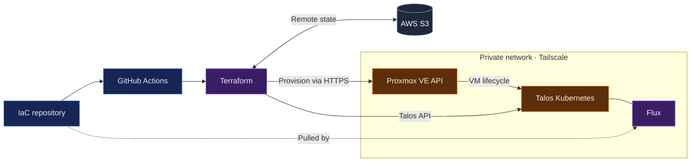

# Platform Automation

This project uses a Proxmox homelab to put platform engineering practices into
use: describing infrastructure in code, reviewing changes before deployment,
and limiting what automation can access. It covers a Kubernetes cluster on
Proxmox and the services running on it, including the work needed to maintain
them after the first deployment.

For homelab builders, the repository offers examples to study and adapt, from
building a Talos cluster to running and backing up apps on it. The code and guides also show
the engineering decisions behind the platform: how changes are checked, where
human approval is required, and how failed deployments are recovered. The
[feature status](#feature-status) makes clear what is implemented and what is
still planned.

## Start here

| I want to… | Start with |
| --- | --- |
| Understand the project and its current scope | [Architecture](#architecture) and [feature status](#feature-status) |
| Deploy or reconcile an existing target | [Deployment workflow and manual modes](docs/deployments.md#manual-modes) |
| Add or change an app | [Kubernetes GitOps](kubernetes/README.md#adding-manifests) and [platform direction](docs/decisions/0001-kubernetes-first.md) |
| Deploy or maintain Kubernetes | [Talos cluster guide](terraform/modules/talos-cluster/README.md) |
| Bootstrap a fork or a new platform | [Setup checklist](#setup) |
| Develop and run checks locally | [Local checks](#local-checks) |
| Recover a failed deployment | [Saved plans and recovery](docs/deployments.md#approval-and-saved-plans) |
| Check backups or recover from a disk failure | [Backups and recovery](docs/backups.md) |

## Architecture



GitHub-hosted runners reach the private network through Tailscale, as ephemeral
nodes authenticated with GitHub OIDC. Terraform creates the Talos node VMs
through the Proxmox HTTPS API and configures them through the Talos API. Apps
are Kubernetes manifests that Flux pulls from `main`. No automation logs in to
a host over SSH; see the [platform direction](docs/decisions/0001-kubernetes-first.md).

## Repository layout

| Path | Purpose |
| --- | --- |
| [terraform/workloads](terraform/workloads) | Environment roots for the Talos cluster and Flux, each with its own state |
| [terraform/platform](terraform/platform) | Administrator-operated Proxmox and AWS configuration, with separate states |
| [terraform/modules](terraform/modules) | The reusable talos-cluster module |
| [kubernetes](kubernetes/README.md) | Cluster manifests that Flux reconciles from `main` |
| [docs](docs) | Platform setup, deployment policies, backups, and decisions |
| [.github/workflows](.github/workflows) | Infrastructure, Talos upgrade, and state unlock workflows |
| [.github/actions](.github/actions) | The shared Tailscale action |

Enabled deployment roots are `dev/talos` and `dev/flux`. `platform/access` is
administrator-operated and excluded from deployment discovery, as is
[`platform/state-access`](terraform/platform/state-access/README.md) for CI AWS
state credentials, [`platform/backup-storage`](terraform/platform/backup-storage/README.md)
for the backup bucket and
[`platform/cluster-oidc`](terraform/platform/cluster-oidc/README.md), which lets
AWS trust the clusters' service account tokens.
Talos is included in automatic discovery and manual deployments. The
`dev/flux` root installs Flux on that cluster; see [Kubernetes GitOps](kubernetes/README.md). See the
[Talos module guide](terraform/modules/talos-cluster/README.md) for networking,
deployment, and cluster lifecycle procedures.

When forking, adapt the environment variables, node addresses, and Tailscale setup
to your own infrastructure before running deployments. To exclude a root from
GitHub Actions, add a `.disabled` file in its directory. This optional marker
excludes it from automatic discovery and manual target selection; local Terraform
commands still work. Remove the marker to include the root again; that change
plans the root like any Terraform change.

## Deployments

The [deployment workflow](.github/workflows/terraform.yml) plans and applies
the Talos and Flux roots. Pull requests run CI and eligible live plans; pushes
to `main` deploy selected work. Feature branches cannot deploy. Fork PRs and
merge queues run credential-free checks without live plans. Kubernetes
manifests never go through CI deployments: Flux applies them after merge.

| Change | Work selected |
| --- | --- |
| Workload Terraform files | Plan the affected enabled root; apply if it has changes. |
| Shared Terraform modules | Plan all enabled roots conservatively. |
| Kubernetes manifests | None in CI; Flux reconciles them from `main`. |
| Documentation only | Run CI; no deployment. |

Dev deployments from pushes to `main` are automatic. Manual dev writes and
production applies require approval; production live plans also require
approval. Ordinary plans can delete or replace resources. Removing a root never
destroys it automatically: destroy it explicitly before removing its
configuration.

For a manual run from `main`, choose an environment, scope and target, then use
`auto` to plan and apply, or `destroy` for explicit teardown.

See [deployments and operations](docs/deployments.md) for full selection rules,
manual modes, branch protection, approval policies, saved plans, concurrency,
and recovery procedures.

## Setup

For a new installation, follow the [complete setup guide](docs/setup.md) in order:

1. Prepare Proxmox storage and networking, workload variables, and runner
   Tailscale access.
2. Bootstrap the S3 state bucket and configure the backend variable.
3. Configure scoped Proxmox and AWS identities and GitHub environment credentials.
4. Generate the plan encryption key pair and configure its GitHub settings.
5. Configure GitHub environment approvals and main branch protection.
6. Verify CI and live plans, then deploy the cluster.

## Local checks

Run Terraform formatting from the repository root:

```sh
terraform fmt -check -recursive terraform
```

The [deployment workflow](.github/workflows/terraform.yml) lists the offline
Python, Node, Terraform and Kubernetes checks run by CI. See
[local Terraform state setup](docs/setup.md#2-configure-terraform-state) for
backend initialization.

## Feature status

This table reflects repository configuration, not externally configured GitHub
protections or the health of deployed services.

| Feature | Status | Coverage and remaining work |
| --- | --- | --- |
| CI cloud access | Implemented | GitHub OIDC assumes one AWS role per environment and operation, with one-hour sessions and no IAM users or access keys. Plan roles cannot read apply parameters. Administrators use IAM Identity Center. |
| CI network access | Implemented | Runners join Tailscale as ephemeral `tag:ci` nodes through GitHub OIDC and reach Proxmox through the subnet router. No network secret is stored, and jobs run in parallel. |
| Secrets management | Implemented | CI reads its secrets from SSM Parameter Store through those roles and masks them before use; the workflows reference no GitHub secrets. Saved plans are encrypted and Talos credentials are ignored. Kubernetes Secrets are committed SOPS-encrypted and decrypted by Flux with an age key only the dev apply role can read. |
| Terraform formatting | Implemented | CI runs `terraform fmt -check -recursive terraform`. |
| Linting and validation | Partial | Terraform validation, Kubernetes manifest builds, and offline tests run in CI. Dedicated Terraform and workflow linting are not configured. |
| Kubernetes GitOps | Partial | Terraform installs the Flux Operator, which reconciles `kubernetes/clusters/dev` from `main`; CI builds the manifests offline. Secrets are SOPS-encrypted. MetalLB and Traefik expose Services on the LAN, and the Proxmox CSI plugin provides persistent volumes. Each app has its own Flux Kustomization. Volumes are LUKS-encrypted on the nodes. Only the podinfo demo runs so far; TLS certificates are not configured. |
| Workload backups | Partial | Flux installs VolSync, which backs up opted-in Kubernetes volumes to encrypted restic repositories in the bucket from [`platform/backup-storage`](terraform/platform/backup-storage/README.md). See [backups and recovery](docs/backups.md). |
| IP address management | Planned | Addresses are supplied explicitly or through DHCP; no IPAM integration allocates addresses or manages reservations. |
| Host access | Not planned | No automation uses SSH; nodes are managed through the Proxmox and Talos APIs. See the [platform direction](docs/decisions/0001-kubernetes-first.md). |
