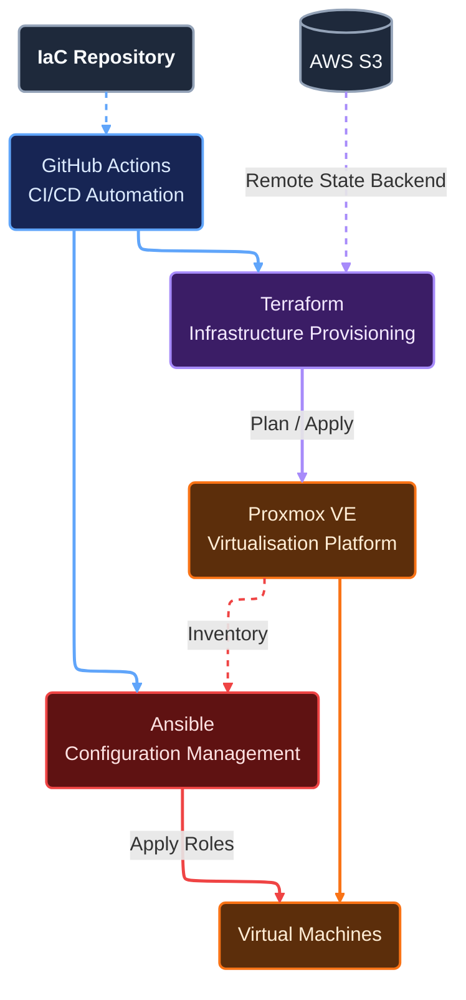

# Platform Automation
This Infrastructure as Code project builds an automation layer on top of Proxmox and is effectively the definition of the desired platform.

It provides the underlying services and automation capabilities required to bootstrap, automate the platform and operate workloads running on it.

## Overview


### Continuous Integration and Delivery
**GitHub Actions**<br>
It's used to gate and automate infrastructure changes. It's source is driven from the repository. 

The CI/CD invokes Terraform to provision infrastructure which is declared in `Environments`.

If required, Ansible is then called to manage the configuration of the infrastructure.

Additionally workflows provided
- Bootstrap AWS S3 storage
- Unlock Terraform State in S3

#### Approval and saved plans

Configure the `proxmox-ro` GitHub environment without required reviewers and the
`proxmox-rw` environment with required reviewers and deployments restricted to
`main`. Keep write credentials and the plan decryption key exclusively in
`proxmox-rw` environment secrets. These protection rules must be configured in
GitHub Settings; the workflow's `environment` field alone does not require approval.

Pull requests run formatting checks, validation, and preview plans for affected
roots. A push to `main` automatically starts the deployment workflow: it plans
affected roots and queues apply for environment approval. There is no separate
manual dispatch needed after merging. Manual runs remain available for a selected
root, including destruction; destruction is never triggered by a push.

For pushes and manual runs on `main`, the plan job saves the plan and provider lock file,
encrypts them with a public key, and uploads only the encrypted archive. After
approval, apply downloads and decrypts that archive and applies the saved plan
before running Ansible for VM targets (images and Talos skip Ansible). Destroy
follows the same process with a saved destroy plan. Pull request runs produce
preview plans without uploading them.

Changes under a Terraform root select that root. Shared module, workflow, or
workflow script changes conservatively select all roots. Deleted roots are not
automatically destroyed: run an explicit manual destroy before removing their
configuration. Apply and destroy share a concurrency group per environment and
target, so their writes cannot overlap and new runs do not cancel an active apply.
GitHub may replace an older pending job when a newer one enters the same group.
Plans may become stale while waiting for approval; regenerate them rather than
applying a newly calculated, unreviewed plan.
All three jobs use Terraform 1.15.8. The Proxmox API token is ephemeral so each
job uses its own environment's credentials rather than saving the read-only
token into the plan.

Generate a dedicated encryption key locally with GnuPG:

```sh
plan_key_dir=$(mktemp -d)
gpg --homedir "$plan_key_dir" --batch --passphrase '' \
  --quick-generate-key 'Terraform plan encryption' rsa3072 encr 1y
gpg --homedir "$plan_key_dir" --armor --export 'Terraform plan encryption' \
  > "$plan_key_dir/public.asc"
gpg --homedir "$plan_key_dir" --batch --pinentry-mode loopback --passphrase '' \
  --armor --export-secret-keys 'Terraform plan encryption' \
  > "$plan_key_dir/private.asc"
```

In GitHub **Settings → Secrets and variables → Actions → Variables**, create
the repository variable `TF_PLAN_PUBLIC_KEY` from the complete contents of
`public.asc`. In **Settings → Environments → proxmox-rw → Environment secrets**,
create `TF_PLAN_PRIVATE_KEY` from the complete contents of `private.asc`.
The dedicated private key has no passphrase; protect it as a secret and do not
commit either generated key file. Store a secure backup and remove the local
temporary key directory after setup. Rotate the key pair before its one-year expiry.

Artifacts expire after seven days and are named per run attempt and Terraform
root. Approve within that period. If the plan becomes stale, the artifact expires,
or you retry a failed deployment, rerun **all jobs** to generate and review a new
plan. There is no fallback that creates a fresh plan during apply. Plan logs
remain visible in this public repository; only the saved binary plan is encrypted.

### Infrastructure Provisioning
**Terraform**<br>
Terraform plan safetly maps what's it's going to create, modify or destroy, in CI/CD this stage has read only access. 

Once the plan has been approved, the Terraform apply/destroy stage is provided write access.

For the backend, object storage such as AWS S3 is recommended. It has state locking support.

The S3 backend is configured at initialisation. Create a GitHub Actions
repository variable named `TF_CLI_ARGS_init` with your bucket and region:

```text
-backend-config=bucket=YOUR_STATE_BUCKET -backend-config=region=YOUR_AWS_REGION
```

The Terraform and State Unlock workflows expose this variable to the runner.
Terraform automatically adds these arguments to `terraform init`. Each workflow
supplies the state key separately as `terraform/<environment>/<target>.tfstate`.

The S3 Bootstrap workflow requires an explicit bucket name. Use that same bucket
and its region in `TF_CLI_ARGS_init` before running the Terraform workflow.

For local use, authenticate to AWS and export the same variable in your shell
(or add it to `~/.bashrc`):

```sh
export TF_CLI_ARGS_init='-backend-config=bucket=YOUR_STATE_BUCKET -backend-config=region=YOUR_AWS_REGION'
terraform -chdir=terraform/environments/dev/k3s init \
  -backend-config="key=terraform/dev/k3s.tfstate"
```

The exported arguments apply to every `terraform init` in that shell.

Modules
  - cloud-image
  - virtual-machine

### Talos cluster

The [Talos module](terraform/modules/talos-cluster/README.md) uses ISO boot,
Talos API configuration, cluster health checks, and sensitive credential outputs.
The dev example is excluded from deployment discovery by a `.disabled` marker
until its DHCP reservations, versions, and any existing-state migration are
reviewed. Offline module tests still run in CI. See the module README for setup,
credential retrieval, rolling upgrades, and migration steps.

### Virtualisation Platform
**Proxmox VE**<br>
This hypervisor provides APIs which are consumed by Terraform and Ansible to create and run Virtual Machines.

### Configuration Management 
**Ansible**<br>
Inventory is dynamically pulled from the Proxmox API. Roles are applied based on tags. If a node has the `managed` tag, they will have the managed ansible roles applied.

Ansible remotes to Virtual Machines with SSHs keys.

### Virtual Machines 
The virtual machines will host services and workloads, any flavour of Linux could work but currently AlmaLinux10 and Ubuntu configuration is supported.

- Services
    - vault
- Workloads
    - k3s

### VPN
**Wireguard**<br>
Connections to the Proxmox API is done securely over Wireguard. With this solution no runner is required in your environment.

## Environment Example
[./terraform/environments/dev/k3s/terraform.auto.tfvars](https://github.com/rauland/iac/blob/main/terraform/environments/dev/k3s/terraform.auto.tfvars)
```
vms = {                              # 1 or more VMs can be defined
  k3s-01 = {                         # name of guest
    node_name = "pve"                # name of pve node
    tags      = ["managed", "k3s"]   # managed for ansible configuration
    cpu       = 2
    memory    = 4096
  }
  k3s-02 = {
    node_name = "pve"
    tags      = ["managed", "k3s"]
    cpu       = 2
    memory    = 4096
  }
}
```

## Limitations
By the ephemeral nature of deployments, destroys and scaling. The assumption is that your infrastructure supports DHCP and dynamic DNS or that you're able to set static IPs.

## Planned Features
### Configuration Management
- K3s Roles
- SSH Certs
- Secrets Management
    - SOPS or Ansible-Vault

### CI/CD
- Linting
    - Terraform fmt

### K8s
- GitOps
- Backup persistent container data to cloud
 
## Future Features
- Static IPAM integration
