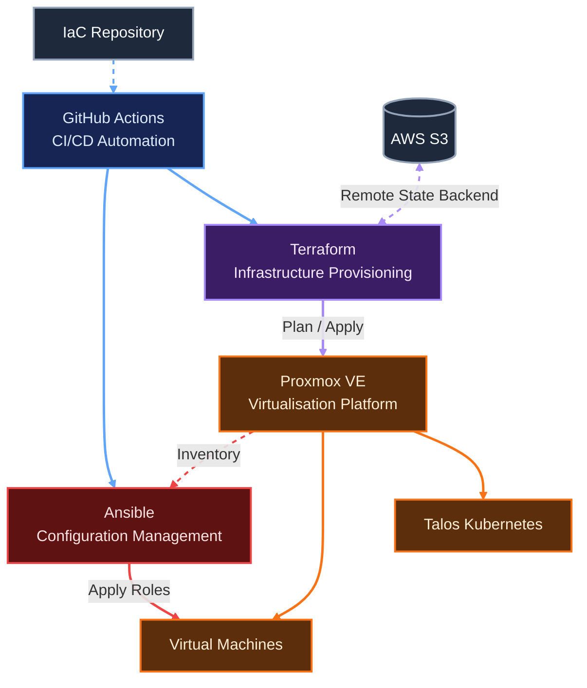

# Platform Automation

Infrastructure as code for a Proxmox platform. Terraform provisions cloud images,
virtual machines, and a Talos Kubernetes cluster. Ansible configures VM services,
and GitHub Actions runs deployments over WireGuard.

## Architecture



GitHub-hosted runners reach the private network through WireGuard. Service VMs
use AlmaLinux 10; Kubernetes nodes use Talos Linux and are configured through the
Talos API.

## Repository layout

| Path | Purpose |
| --- | --- |
| [terraform/workloads](terraform/workloads) | Environment workload roots, each with its own state |
| [terraform/platform](terraform/platform) | Shared images and administrator-operated Proxmox/AWS access configuration, with separate states |
| [terraform/modules](terraform/modules) | Reusable cloud-image, virtual-machine, and talos-cluster modules |
| [ansible](ansible/README.md) | Dynamic Proxmox inventory, playbooks, and roles |
| [ssh](ssh/README.md) | Environment-specific public keys, verified host keys, and SSH rotation |
| [.github/workflows](.github/workflows) | Infrastructure/configuration, S3 bootstrap, and state unlock workflows |
| [.github/actions](.github/actions) | Shared WireGuard, SSH, and Ansible actions |

Enabled deployment roots are `dev/sandbox`, `dev/vault`, `dev/talos`, and
[`platform/images`](terraform/platform/images/README.md). `platform/access` is
administrator-operated and excluded from deployment discovery, as is
[`platform/state-access`](terraform/platform/state-access/README.md) for CI AWS
state credentials.
Talos is included in automatic discovery and manual deployments. See the
[Talos module guide](terraform/modules/talos-cluster/README.md) for networking,
deployment, and cluster lifecycle procedures.

When forking, adapt the environment variables, VM addresses, and WireGuard setup
to your own infrastructure before running deployments. To exclude a root from
GitHub Actions, add a `.disabled` file in its directory. This optional marker
excludes it from automatic discovery and manual target selection; local Terraform
commands still work. Remove the marker to include the root again.

## Deployments

The [deployment workflow](.github/workflows/terraform.yml) handles Terraform and
Ansible independently. It runs on every pull request to `main`, every push to
`main`, merge-queue validation, and manual requests. Feature branches use the
same PR checks; they cannot deploy. The stable **CI** check runs without
infrastructure secrets and reports even for documentation-only pull requests.

| Change | Work selected |
| --- | --- |
| Workload Terraform files | Plan that enabled root; apply only if the plan has changes. |
| Shared Terraform modules | Plan all enabled roots conservatively. |
| Ansible role, playbook, inventory, or runtime requirements | Configure affected VM targets without requiring Terraform. |
| Environment SSH public keys | Plan that environment's roots and configure its VM targets. |
| Verified SSH host keys or a running guest agent for managed guests | Configure VM targets; CI can enroll unpinned guests through the scoped Proxmox apply identity. |
| Documentation, tests, lint policy, or pipeline implementation only | Run CI; no deployment. |

Shared baseline roles select enabled VM targets. Vault-specific files select
only Vault targets. Images and Talos never run Ansible. Any actual infrastructure
change to a VM target also runs Ansible after the saved plan is successfully
applied. A no-op Terraform plan does not suppress separately requested Ansible
work. Removed roots are never destroyed automatically: destroy them explicitly
before removing their configuration.

### Manual modes

Run the deployment workflow from `main`, choose an environment (`dev`, `prod`,
or `platform`), and choose `single` or `all` scope. Single scope also requires a
target; all scope selects enabled targets in the chosen environment.

| Mode | Behavior |
| --- | --- |
| `auto` | Reconcile the selected infrastructure and VM configuration, including Ansible when Terraform has no changes. |
| `infrastructure` | Plan/apply the selected roots; configure VM targets after actual infrastructure changes. |
| `configuration` | Run Ansible only; no Terraform plan or apply. |
| `destroy` | Generate and apply an explicitly requested destroy plan after approval; never run Ansible. |

For configuration-only single runs, targets are `common`, `sandbox`, or `vault`
in dev/prod. They may configure existing guests without a matching Terraform
root. All-scope configuration selects enabled VM workload roots. Use
`platform/images` for shared cloud-image publishing. The separate Ansible
workflow has been consolidated into this workflow.

For guests without agents or VMs created outside Terraform, keep a verified
entry in `ssh/known_hosts/ENVIRONMENT` and use `configuration` mode. Pinned
guests do not require guest-agent enrollment or Terraform state. See the
[manual onboarding procedure](ssh/README.md#manual-onboarding-without-a-guest-agent)
for pool membership, inventory addresses, SSH access and optional Terraform
import outside CI.

### Main branch protection

The main ruleset requires a pull request, a successful **CI** result produced by
GitHub Actions, and an up-to-date branch. Force pushes and branch deletion are
blocked, with no bypass actors. The desired configuration is recorded in
[main-ruleset.json](.github/policies/main-ruleset.json); enforcement lives in
GitHub repository settings. Required CI jobs cannot depend on deployment approval.

The ruleset requires zero approving PR reviews to support a solo maintainer;
PRs, passing checks, and resolving review conversations are still required.
This is separate from the mandatory production deployment review. If a team
joins the repository, increase the approving PR review count in the ruleset.

### Approval and saved plans

The [Proxmox access root](terraform/platform/access/README.md) documents scoped
users, token export, and state IAM requirements. GitHub environments supply
credentials and enforce the following deployment policies:

| Environment | Access | Protection |
| --- | --- | --- |
| `proxmox-dev-plan` | Dev audit credentials plus refresh permissions | No required reviewers |
| `proxmox-prod-plan` | Prod audit credentials plus refresh permissions | Required human approval, including PR previews |
| `proxmox-dev-auto-apply` | Dev write/inventory credentials and plan decryption key | Automatic deployments from pushes to `main` only |
| `proxmox-dev-apply` | Dev write credentials for manual reconciliation, destroy, and state unlock | Required reviewers; `main` only |
| `proxmox-prod-apply` | Prod write/inventory credentials and plan decryption key | Required human approval for infrastructure and Ansible-only changes; `main` only |
| `proxmox-platform-plan` | Shared-image audit credentials | No required reviewers |
| `proxmox-platform-apply` | Image publishing credentials and plan decryption key | Required reviewers; `main` only |

Required reviewers and branch restrictions must exist in GitHub environment
settings; referencing an environment in YAML alone does not require approval.
Production currently names the repository owner as required reviewer, allows
that human to approve their own initiated run, and disables administrator
bypasses. Plan approval and deployment approval remain separate. When Terraform
and Ansible both need to run, one deployment approval covers both tools.

Live plans are allowed only for same-repository PRs and trusted `main` runs.
Fork PRs and merge queues run the credential-free checks without live plans.
Production plan approval is not a required merge check. Write credentials and
plan decryption keys stay exclusively in deployment environments.

Terraform uses `-detailed-exitcode`: 0 means no changes, 2 means changes, and an
error fails the run. Each matrix target uploads its own non-secret result,
bound to the commit, workflow run, attempt, target, and destroy mode. The
preparation job validates every expected result and publishes a deployment
summary before any deployment approval is requested. Missing or mismatched
results fail closed. No-op targets with no Ansible work do not create deployment
jobs or request deployment approval.

Same-repository PRs receive one deployment preview comment with the readable
Terraform plan for every selected target, including no-change plans. Later runs
update the comment and identify the PR commit and workflow run. Large plans are
truncated with a link to the full job logs. The same preview appears in the
workflow run summary; configuration-only changes explicitly say no plans were
needed. Fork PRs do not publish a comment.

Only changed plans from `main` are encrypted and uploaded together with their
provider lock file and a manifest bound to the plan, target, commit and run.
Sandbox's API-uploaded cloud-init seed ISO is included in that encrypted
artifact and verified against its saved SHA256 before apply. It enables
agent-based SSH enrollment with SELinux enforcing and needs no Proxmox-host
SSH. Other VM roots retain their existing initialization path.
Apply executes the saved infrastructure plan. For newly created VMs, tags are
deferred until pool assignment so the existing pool-scoped token can set them.
A follow-up saved plan is allowed to apply only the exact reviewed tags to
those new VM IDs; unrelated changes fail validation before that plan is applied.
The preview shows the intended final tags and identifies staged resources.
Existing VM updates and destroy plans use their original saved plan directly.
See [VM tag staging](terraform/modules/virtual-machine/README.md#pool-scoped-creation-and-tags)
for the validation boundaries and recovery procedure.

The Terraform API token remains ephemeral and is supplied by the job's selected
environment. Result artifacts contain routing flags,
commit/run identifiers, and the human-readable output of `terraform show
-no-color tfplan`, which hides values marked sensitive by Terraform. Raw JSON
plans are not published. Plan text and logs remain visible in this public
repository; saved plan archives are encrypted.

Artifacts are unique to each run attempt and target and expire after seven
days. If a plan becomes stale, an artifact expires, or a deployment fails,
rerun **all jobs** so the plan, result metadata, and approval summary match.
Automatic dev applies may delete or replace resources when an ordinary plan
contains those actions; explicit destroy approval is not a deletion filter on
normal plans. Terraform deployment jobs use version `1.15.8`.

### Concurrency and networking

The [WireGuard action](.github/actions/wireguard/action.yml) uses one shared
runner profile through its environment secrets. Its private route is
`10.0.0.0/24`. Plan and deployment jobs share the `iac-private-network`
concurrency group and use `cancel-in-progress: false`, preventing overlapping
use of the shared peer or concurrent deployments. Matrices also use
`max-parallel: 1`. GitHub may replace an older pending job with a newer one;
missing plan results prevent partial runs from deploying. Rerun all jobs after
a cancellation. State unlock remains an explicit, approved recovery operation.

## Setup

### Terraform state

Run the [S3 Bootstrap workflow](.github/workflows/bootstrap.yml) with an explicit
bucket name and region. The Terraform roots use an encrypted S3 backend with
lock files enabled.

Create the repository variable `TF_CLI_ARGS_init` in GitHub **Settings → Secrets
and variables → Actions → Variables**:

```text
-backend-config=bucket=YOUR_STATE_BUCKET -backend-config=region=YOUR_AWS_REGION
```

Terraform and State Unlock use this variable during initialization and supply
the state key separately as `terraform/<environment>/<target>.tfstate`. Use the
same bucket and region you selected during bootstrap.
Workload state keys retain this format even though source directories live
under `terraform/workloads`; the directory rename does not move remote state.

For local use, authenticate to AWS and export the variable:

```sh
export TF_CLI_ARGS_init='-backend-config=bucket=YOUR_STATE_BUCKET -backend-config=region=YOUR_AWS_REGION'
terraform -chdir=terraform/workloads/dev/sandbox init \
  -backend-config="key=terraform/dev/sandbox.tfstate"
```

The exported arguments apply to every `terraform init` in that shell. The
[State Unlock workflow](.github/workflows/state-unlock.yml) accepts an environment,
target, and lock ID for the corresponding state.

### Plan encryption

Generate a dedicated encryption key locally with GnuPG:

```sh
plan_key_dir=$(mktemp -d)
gpg --homedir "$plan_key_dir" --batch --passphrase '' \
  --quick-generate-key 'Terraform plan encryption' rsa3072 encr 1y
gpg --homedir "$plan_key_dir" --armor --export 'Terraform plan encryption' \
  > "$plan_key_dir/public.asc"
gpg --homedir "$plan_key_dir" --batch --pinentry-mode loopback --passphrase '' \
  --armor --export-secret-keys 'Terraform plan encryption' \
  > "$plan_key_dir/private.asc"
```

| GitHub setting | Value |
| --- | --- |
| Repository variable `TF_PLAN_PUBLIC_KEY` | Complete contents of `public.asc` |
| Each apply environment secret `TF_PLAN_PRIVATE_KEY` | Complete contents of `private.asc` |

The dedicated private key has no passphrase. Keep a secure backup, remove the
temporary key directory after setup, and rotate the pair before its one-year
expiry. Do not commit the generated files.

## VM configuration with Ansible

Ansible discovers VMs through the Proxmox inventory and connects over SSH as
`ansible` with sudo access. Each run intersects the environment pool group
(`proxmox_pool_dev` or `proxmox_pool_prod`) with the selected target tag.
Environment tags are optional; pool membership determines the environment.

| VM tags | Playbooks for a matching target run |
| --- | --- |
| `common` | `common.yml`: timezone, Ansible user, and packages |
| `common` + `vault` | `common.yml`, then `vault.yml` |
| `common` + `sandbox` | `common.yml`, then `sandbox.yml` |
| `vault` or `sandbox`, without `common` | Corresponding service playbook only |
| No matching tag | Skipped |

The common baseline is optional and does not exclude service roles. `common`
is the VM tag and runner target, and creates the `tag_common` inventory group.
OS-family differences are handled inside roles; Vault currently
supports RHEL-family guests with DNF and EPEL. Sandbox guests also tagged
`podman` run an Nginx site through the [Podman role](ansible/roles/podman/README.md).
See [Ansible deployment targets](ansible/README.md)
for credentials, inventory conventions, and offline checks.

Preview a Vault run from the repository root:

```sh
bash ansible/run-playbook.sh dev vault --list-hosts
bash ansible/run-playbook.sh dev vault --check
```

### Example VM

The [sandbox variables](terraform/workloads/dev/sandbox/terraform.auto.tfvars)
include target tags, and the sandbox root assigns the VM to the `dev` pool.
The existing `dev` tag is optional and is not used by the runner:

```hcl
vms = {
  podman = {
    vm_name         = "podman"
    node_name       = "pve"
    tags            = ["dev", "common", "sandbox", "podman"]
    cpu             = 2
    memory          = 4096
    image_file_name = "AlmaLinux-10-GenericCloud-latest.x86_64.qcow2"
  }
}
```

VM networking requires DHCP and dynamic DNS or explicitly configured static
addresses. Talos requires the DHCP reservations described in its module guide.

The sandbox is a testing environment that currently runs Nginx on Podman.
CI enrolls an unpinned guest's SSH host key through the authenticated Proxmox
guest agent before Ansible runs, so no manual key addition is needed. The agent
must already be running in the cloud image. Existing entries in
`ssh/known_hosts/dev` remain authoritative. If a VM reuses a pinned address with
a different key, verify and update that pin explicitly. If configuration fails after provisioning,
rerun `configuration` mode for `dev/sandbox` to finish without recreating the VM.
See [SSH enrollment](ssh/README.md#host-verification) for the trust checks. The
Nginx site will be available at `http://VM_ADDRESS/` on port 80 after
configuration succeeds.

## Feature status

This table reflects repository configuration, not externally configured GitHub
protections or the health of deployed services.

| Feature | Status | Coverage and remaining work |
| --- | --- | --- |
| SSH certificates | Planned | VM access uses SSH keys and cloud-init; no SSH CA or certificate lifecycle is configured. |
| Secrets management | Partial | GitHub Actions secrets, encrypted saved plans, and ignored Talos credentials are in place. Vault provisioning and an Ansible role exist; automated initialization, unsealing, and workload secret retrieval are not configured. |
| Terraform formatting | Implemented | CI runs `terraform fmt -check -recursive terraform`. |
| Linting and validation | Partial | Ansible linting, Terraform validation, and offline tests run in CI. Dedicated Terraform and workflow linting are not configured. |
| Kubernetes GitOps | Planned | No Flux or Argo CD bootstrap or workload reconciliation is configured. |
| Workload backups | Planned | No workload backup or restore process is configured. S3 stores Terraform state only. |
| IP address management | Planned | Addresses are supplied explicitly or through DHCP; no IPAM integration allocates addresses or manages reservations. |
