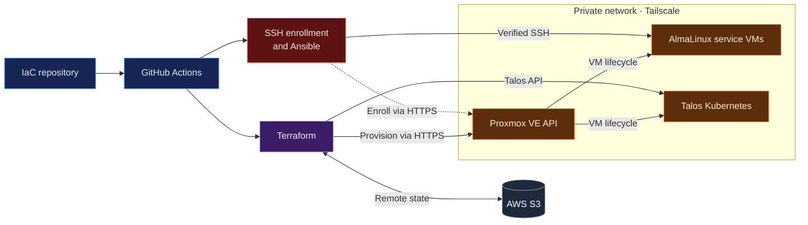

# Platform Automation

This project uses a Proxmox homelab to put platform engineering practices into
use: describing infrastructure in code, reviewing changes before deployment,
and limiting what automation can access. It covers virtual machines, Kubernetes,
and the services running on them, including the work needed to maintain them
after the first deployment.

For homelab builders, the repository offers examples to study and adapt, from
automating a VM to managing a Kubernetes cluster. The code and guides also show
the engineering decisions behind the platform: how changes are checked, where
human approval is required, and how failed deployments are recovered. The
[feature status](#feature-status) makes clear what is implemented and what is
still planned.

## Start here

| I want to… | Start with |
| --- | --- |
| Understand the project and its current scope | [Architecture](#architecture) and [feature status](#feature-status) |
| Deploy or reconcile an existing target | [Deployment workflow and manual modes](docs/deployments.md#manual-modes) |
| Add or change a VM workload | [Sandbox example](docs/deployments.md#example-vm), [VM module](terraform/modules/virtual-machine/README.md), and [Ansible targets](ansible/README.md) |
| Deploy or maintain Kubernetes | [Talos cluster guide](terraform/modules/talos-cluster/README.md) |
| Bootstrap a fork or a new platform | [Setup checklist](#setup) |
| Develop and run checks locally | [Local checks](#local-checks) |
| Recover a failed deployment | [Saved plans and recovery](docs/deployments.md#approval-and-saved-plans) |

## Architecture



GitHub-hosted runners reach the private network through Tailscale, as ephemeral
nodes authenticated with GitHub OIDC. Terraform
manages VMs, images and seed ISOs through the Proxmox HTTPS API. Service VMs use
AlmaLinux 10; Kubernetes nodes use Talos Linux and are configured through the
Talos API. Inventory discovery and host-key enrollment also use the Proxmox API.
Enrollment verifies managed VM identity before Ansible connects with strict
host-key checking. See [SSH host verification](ssh/README.md#host-verification)
for the trust checks and guest-agent requirements.

## Repository layout

| Path | Purpose |
| --- | --- |
| [terraform/workloads](terraform/workloads) | Environment workload roots, each with its own state |
| [terraform/platform](terraform/platform) | Shared images and administrator-operated Proxmox/AWS access configuration, with separate states |
| [terraform/modules](terraform/modules) | Reusable cloud-image, virtual-machine, and talos-cluster modules |
| [kubernetes](kubernetes/README.md) | Cluster manifests that Flux reconciles from `main` |
| [ansible](ansible/README.md) | Dynamic Proxmox inventory, playbooks, and roles |
| [ssh](ssh/README.md) | Environment-specific public keys, verified host keys, and SSH rotation |
| [docs](docs) | Platform setup, deployment policies, and recovery procedures |
| [.github/workflows](.github/workflows) | Infrastructure/configuration, S3 bootstrap, and state unlock workflows |
| [.github/actions](.github/actions) | Shared Tailscale, SSH, and Ansible actions |

Enabled deployment roots are `dev/sandbox`, `dev/talos`, and
[`platform/images`](terraform/platform/images/README.md). `platform/access` is
administrator-operated and excluded from deployment discovery, as is
[`platform/state-access`](terraform/platform/state-access/README.md) for CI AWS
state credentials.
Talos is included in automatic discovery and manual deployments. The
`dev/flux` root installs Flux on that cluster; see [Kubernetes GitOps](kubernetes/README.md). See the
[Talos module guide](terraform/modules/talos-cluster/README.md) for networking,
deployment, and cluster lifecycle procedures.

When forking, adapt the environment variables, VM addresses, and Tailscale setup
to your own infrastructure before running deployments. To exclude a root from
GitHub Actions, add a `.disabled` file in its directory. This optional marker
excludes it from automatic discovery and manual target selection; local Terraform
commands still work. Remove the marker to include the root again.

## Deployments

The [deployment workflow](.github/workflows/terraform.yml) selects Terraform and
Ansible work independently. Pull requests run CI and eligible live plans;
pushes to `main` deploy selected work. Feature branches cannot deploy. Fork PRs
and merge queues run credential-free checks without live plans.

| Change | Work selected |
| --- | --- |
| Workload Terraform files | Plan the affected enabled root; apply if it has changes. |
| Shared Terraform modules | Plan all enabled roots conservatively. |
| Ansible configuration | Configure affected VM targets independently of Terraform. |
| Environment SSH public keys | Plan that environment's roots and configure its VM targets. |
| Documentation only | Run CI; no deployment. |

Dev deployments from pushes to `main` are automatic. Manual dev writes and
production/platform applies require approval; production live plans also
require approval. Ordinary plans can delete or replace resources. Removing a
root never destroys it automatically: destroy it explicitly before removing
its configuration.

For a manual run from `main`, choose an environment, scope and target, then use
`auto` to reconcile infrastructure and configuration, `infrastructure` for
Terraform, `configuration` for Ansible, or `destroy` for explicit teardown.
Images, Talos and Flux never run Ansible.

See [deployments and operations](docs/deployments.md) for full selection rules,
manual modes, branch protection, approval policies, saved plans, concurrency,
and recovery procedures.

## Setup

For a new installation, follow the [complete setup guide](docs/setup.md) in order:

1. Prepare Proxmox storage and networking, workload variables, and runner
   Tailscale access.
2. Bootstrap the S3 state bucket and configure the backend variable.
3. Configure scoped Proxmox and AWS identities and GitHub environment credentials.
4. Set environment-specific SSH keys, host verification, and service credentials.
5. Generate the plan encryption key pair and configure its GitHub settings.
6. Configure GitHub environment approvals and main branch protection.
7. Verify CI and live plans, publish shared images, then deploy a workload.

## Local checks

Run Terraform formatting from the repository root:

```sh
terraform fmt -check -recursive terraform
```

Use the [Ansible lint instructions](ansible/README.md#linting) for its pinned
local environment. The [deployment workflow](.github/workflows/terraform.yml)
lists the offline Python, Node, and Terraform checks run by CI.

For a live Ansible preview after configuring credentials, inventory and SSH trust:

```sh
bash ansible/run-playbook.sh dev sandbox --list-hosts
bash ansible/run-playbook.sh dev sandbox --check
```

See [local Terraform state setup](docs/setup.md#2-configure-terraform-state)
for backend initialization and [Ansible deployment targets](ansible/README.md)
for VM tags, playbooks, credentials, and inventory conventions.

## Feature status

This table reflects repository configuration, not externally configured GitHub
protections or the health of deployed services.

| Feature | Status | Coverage and remaining work |
| --- | --- | --- |
| CI cloud access | Implemented | GitHub OIDC assumes one AWS role per environment and operation, with one-hour sessions and no IAM users or access keys. Plan roles cannot read apply parameters. Administrators use IAM Identity Center. |
| CI network access | Implemented | Runners join Tailscale as ephemeral `tag:ci` nodes through GitHub OIDC and reach Proxmox through the subnet router. No network secret is stored, and jobs run in parallel. |
| Secrets management | Implemented | CI reads its secrets from SSM Parameter Store through those roles and masks them before use; the workflows reference no GitHub secrets. Saved plans are encrypted and Talos credentials are ignored. Workload secret delivery inside the cluster is not configured. |
| Terraform formatting | Implemented | CI runs `terraform fmt -check -recursive terraform`. |
| Linting and validation | Partial | Ansible linting, Terraform validation, and offline tests run in CI. Dedicated Terraform and workflow linting are not configured. |
| Kubernetes GitOps | Partial | Terraform installs the Flux Operator, which reconciles `kubernetes/clusters/dev` from `main`; CI builds the manifests offline. The `dev/flux` root starts disabled until the Talos root exports its API credentials. No workloads or SOPS secret decryption are configured yet. |
| Workload backups | Planned | No workload backup or restore process is configured. S3 stores Terraform state only. |
| IP address management | Planned | Addresses are supplied explicitly or through DHCP; no IPAM integration allocates addresses or manages reservations. |
| SSH certificates | Not planned | VM access uses per-environment SSH keys, cloud-init and verified host pins. One CI identity per environment does not justify running an SSH CA. |
