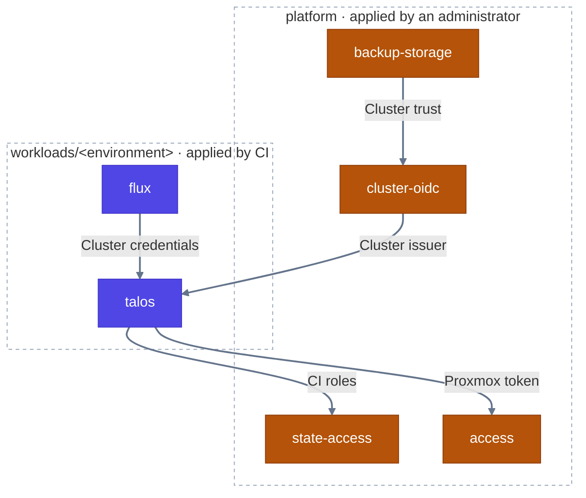

# Terraform roots

Each directory with a `main.tf` under `workloads` and `platform` is a root
module with its own state in S3. CI plans and applies the workload roots;
administrators apply the platform roots with their own credentials, and
deployment discovery never selects them. [modules](modules) holds the shared
[talos-cluster](modules/talos-cluster/README.md) module.

| Root | Applied by | Creates | Needs |
| --- | --- | --- | --- |
| [platform/state-access](platform/state-access/README.md) | Administrator | CI's OIDC roles for Terraform state and SSM parameters | None |
| [platform/access](platform/access/README.md) | Administrator | Proxmox pools, users, API tokens and storage | None |
| `workloads/<environment>/talos` | CI | The cluster's VMs and Talos configuration; its client configuration as an output | A CI role, and a Proxmox token in SSM |
| `workloads/<environment>/flux` | CI | Flux, syncing `kubernetes/clusters/<environment>` | The `talos` root's client configuration, read from its state |
| [platform/cluster-oidc](platform/cluster-oidc/README.md) | Administrator | AWS trust for each cluster's service account tokens | Each cluster's API address and credentials, read from its `talos` state, to fetch the issuer's keys |
| [platform/backup-storage](platform/backup-storage/README.md) | Administrator | The backup bucket and one IAM role per cluster | Each cluster's OIDC provider, read from `cluster-oidc` state |

Arrows point from a root to what it needs. Apply a new installation in that
order:

1. `platform/state-access` and `platform/access`, then put their credentials in
   SSM as the [setup guide](../docs/setup.md) describes.
2. `talos`, then `flux`, for each environment. CI does both after merge; on a
   rebuilt cluster, apply `talos` before `flux` plans, as the Flux plan reads
   the cluster that existed when it started.
3. `platform/cluster-oidc` once each cluster exists, then
   `platform/backup-storage`, before turning on volume backups.

Removing a root never destroys it: destroy it explicitly before deleting its
directory. See [deployments](../docs/deployments.md) for how CI selects roots.
