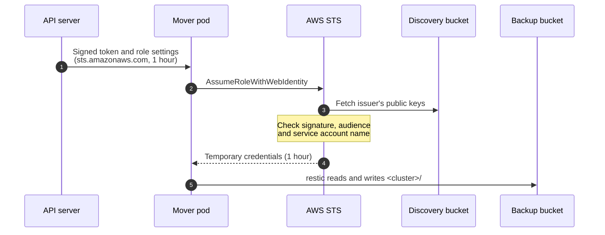

# Cluster OIDC discovery

This administrator-operated root lets AWS trust the service account tokens of
each Kubernetes cluster, so pods reach AWS with short-lived credentials instead
of stored access keys. It is excluded from automatic deployment discovery; CI
cannot plan or apply it.

AWS verifies a token by fetching its issuer's discovery document and signing
keys over public HTTPS. The clusters' API servers are not reachable from the
internet, so this root copies the two documents from each API server to a
public S3 bucket, and registers each cluster as an IAM identity provider.

## What it creates

| Resource | Notes |
| --- | --- |
| S3 bucket (`bucket_name`) | Serves `<cluster>/.well-known/openid-configuration` and `<cluster>/openid/v1/jwks` publicly, and nothing else. The documents hold only public keys. TLS only. |
| IAM OIDC identity provider per cluster | Issuer `https://<bucket>.s3.<region>.amazonaws.com/<cluster>`, audience `sts.amazonaws.com`. Roles that trust it are defined where they are used, such as [`platform/backup-storage`](../backup-storage/README.md). |

The provider alone grants nothing: a pod gets AWS access only through a role
whose trust policy names the provider, the audience and the pod's service
account.

## How it works

A pod reaches AWS without a stored key in five steps, shown here for a VolSync
mover pod backing up a volume:



1. The pod starts with a token and the settings to use it. When VolSync
   creates a mover pod, a
   [MutatingAdmissionPolicy](../../../kubernetes/infrastructure/volsync/aws-identity.yaml)
   adds a projected token volume and the variables `AWS_ROLE_ARN`,
   `AWS_WEB_IDENTITY_TOKEN_FILE` and `AWS_REGION`. The kubelet then mounts a
   service account token that the API server signs as the public issuer, for
   the audience `sts.amazonaws.com`, valid for an hour and refreshed before it
   expires.
2. restic's S3 client sees the variables and calls STS
   `AssumeRoleWithWebIdentity` with the token.
3. STS fetches the issuer's discovery document and public keys from this
   root's bucket. It checks the token's signature and issuer, then the role's
   trust policy: the audience, and a subject of
   `system:serviceaccount:<namespace>:volsync-src-*` or `volsync-dst-*`.
4. STS returns temporary credentials for the role, valid for an hour.
5. restic uses them to read and write the cluster's prefix in the
   [backup bucket](../backup-storage/README.md), and nothing else.

### Where the signing key lives

The private key that signs service account tokens is one of the Talos machine
secrets that the cluster's Talos root generates. It is kept in two places:

- that root's Terraform state, in the encrypted, versioned state bucket, which
  only the environment's plan and apply roles and administrators can read;
- the control planes' machine configuration, on the `STATE` partition that
  Talos encrypts with a TPM-sealed key (see
  [system-volume encryption](../../modules/talos-cluster/README.md#secure-boot-and-system-volume-encryption)).

The public bucket holds only the matching public keys. Anyone who can read the
Talos state or administer a control plane can sign tokens AWS accepts, but
those people already control the cluster, so the issuer adds no new way in.
Rotating the key means recreating the machine secrets, which rebuilds the
cluster's credentials, and then applying this root again.

### Who can assume a role

AWS trusts the token's subject, not the pod. The backup roles match a service
account name pattern in any namespace, so anyone who can create a service
account named `volsync-src-<anything>` and a pod that uses it gets the
cluster's backup role. Grant that permission only to people who may read and
delete backups. To narrow it, list exact `<namespace>:<service account>` pairs
in the role's trust policy instead, at the cost of a Terraform change for each
backed-up volume.

## Prepare the cluster

Set the cluster's Talos root to sign tokens as the bucket's issuer, and let CI
apply it:

```hcl
service_account_issuer = "https://<bucket>.s3.<region>.amazonaws.com/<cluster>"
```

See [public service account issuer](../../modules/talos-cluster/README.md#public-service-account-issuer).
This root refuses to publish a cluster whose API server still reports another
issuer.

## Apply

Run from the repository root, on a machine that can reach the clusters' API
servers, after authenticating with the `admin` profile as described in
[state-access](../state-access/README.md#authenticate-with-temporary-administrator-credentials).
The root reads each cluster's administrator certificate from its Talos state:

```sh
(
  unset AWS_ACCESS_KEY_ID AWS_SECRET_ACCESS_KEY AWS_SESSION_TOKEN AWS_SECURITY_TOKEN
  export AWS_PROFILE=admin
  aws sts get-caller-identity &&
  terraform -chdir=terraform/platform/cluster-oidc init \
    -backend-config=bucket=rauland-iac-homelab \
    -backend-config=region=ap-southeast-2 \
    -backend-config=key=terraform/platform/cluster-oidc.tfstate &&
  terraform -chdir=terraform/platform/cluster-oidc plan -out=tfplan \
    -var state_bucket=rauland-iac-homelab
)
```

Review the plan, then apply it with
`terraform -chdir=terraform/platform/cluster-oidc apply tfplan` in the same kind
of subshell. Bucket names are global, so a fork must set its own `bucket_name`.
If the account blocks public bucket policies account-wide, the bucket policy
is rejected; allow it for this bucket.

Apply again whenever a cluster's signing keys change, which happens only when
its Talos machine secrets are recreated, such as when the cluster is built from
scratch. Until then, AWS rejects the new cluster's tokens.

## Checks

Run `terraform validate` and the offline tests with `terraform test` from this
directory. The tests assert that the documents come from the API server, that
only they are public, and that a cluster still on its private issuer is refused.
